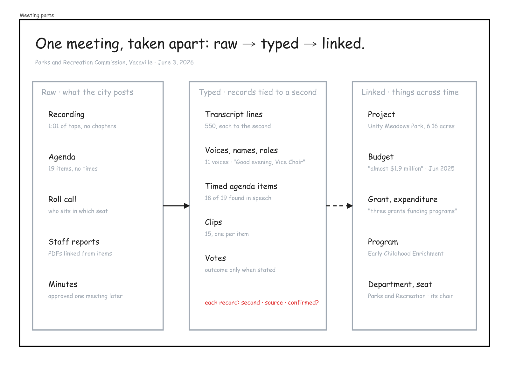

## Executive Summary {-}

A city decides in public, and the record of those decisions is mostly a recording that nobody opens again.
GovCenter, a research project by Civic Studio, distills each public meeting and its supporting materials into data that people and tools can use.
Every fact is tied to a second of the recording, says where it came from, and says whether a person has confirmed it.
On seven meetings of one commission, the agenda was placed on the recording from speech alone for 97% of items, and a park project was followed across fourteen months without anyone writing its history by hand.

# Introduction

Public meetings are where local government reasons out loud.
A commission hears a park plan in March, revisits it in May and votes in June.
Each time, staff, officials and residents bring what they remember to the room.
The record holds more than anyone remembers, but finding it means scrubbing hours of video and cross-reading agendas and staff reports by hand.

That work is a coordination cost.
When nobody pays it, each decision is made with less context than already exists.
When one person pays it privately, the context they build disappears into their notes.

This paper asks a narrow question: can a meeting and its papers be distilled, mostly by machine and confirmed by a person, into metadata robust enough that other people and other tools can use it?
We give "usable" a test.
Every fact must cite a second of the recording, name its source, and carry its review status.

# Three Forms of One Meeting

We treat a meeting as data in three forms.
Each form is kept, and each points back to the form below it.

| Form | What it is | Examples |
|--------|--------------------------|--------------------------|
| Raw | What the city publishes, kept exactly as published | Recording, agenda, roll call, staff reports, minutes |
| Typed | Records anchored to a second, each with source, confidence and status | Transcript lines, voice turns, names and roles, timed agenda items, clips, votes |
| Linked | Real-world things with an identity across meetings and years | Projects, budgets, programs, departments, expenditures, seats |

Raw is the evidence.
Typed makes one meeting navigable.
Linked makes many meetings into a history of what a city is actually doing.

{width=100%}

# Inputs

The method uses only what the city already publishes.

| Input | What it carries |
|---|---|
| Recording | Everything that was said, untimed and unlabeled |
| Agenda | Item numbers and titles, in order, without times |
| Roll call | Who sits on the body, and in which seat |
| Staff reports | The detail behind an item, linked from the agenda |
| Earlier meetings | Who spoke before and what was heard before |

No outside news, social media or commercial data is used.
In the study city, Vacaville, California, recordings and agendas came from Granicus until May 2026 and from eScribe after.

# Method

The passes run in order, and each can be re-run without losing human work.

1. **Collect.**
   Discover each meeting on the city's portal and download its recording and agenda.
2. **Transcribe.**
   Speech recognition (Whisper) produces lines stamped with their start and end seconds.
3. **Window.**
   Find the meeting inside the recording, from the call to order to the adjournment after which meeting talk stops.
   Recordings often continue for hours after a meeting ends.
4. **Separate voices.**
   Speaker diarization splits the meeting into anonymous voices and turns.
5. **Name voices.**
   Propose a name for each voice from what is said in the room ("my name is", "we will hear from", "good evening, Vice Chair"), and resolve spellings and roles against the roll call.
   Each voice also gets a signature, so a name confirmed in one meeting is suggested for the same voice in others.
6. **Place the agenda.**
   Score each agenda item's title words against the transcript, weighted by rarity within the meeting and by spoken hand-offs ("next we have"), and place items strictly in agenda order.
   An item never spoken is placed by interpolation with confidence zero.
7. **Cut clips and find votes.**
   Each item becomes a clip.
   A vote is anchored where it is called ("all those in favor") or its result stated ("motion carries").
8. **Thread topics.**
   Distinctive phrases from agenda titles are found in other meetings' agendas and transcripts, and kept when they recur.
9. **Confirm.**
   A person confirms, corrects or rejects each suggestion before it is shown publicly.

Every typed record carries three fields.
*Source* says how it was made: transcript, cue, voice, roster, interpolated or manual.
*Confidence* is a number when a machine made it.
*Status* is suggested, confirmed or rejected, and a re-run never overwrites a person's decision.

The method holds to six rules.
The city's record is the only source.
Say only what was said: a vote is "carried" or "failed" only when someone said so, and tallies are not guessed from a chorus of ayes.
Machine output is a suggestion until a person confirms it.
Confirm once: a confirmed voice is recognized in later meetings.
Keep the gaps: an unspoken item is marked as interpolated, not hidden.
Name officials and staff, not members of the public, who are shown as "Public speaker" while the transcript keeps what they said.

# Evaluation

We applied the method to the seven meetings of the Vacaville Parks and Recreation Commission in which one project, Unity Meadows Park, was discussed, from June 2025 to August 2026.
Counts are from the record on November 2, 2026.
Words are counted inside the meeting window; "from speech" counts agenda items placed from the transcript, and votes are machine suggestions awaiting confirmation.

| Meeting | Words | Voices | Turns | Items | From speech | Clips | Votes |
|------------|-------:|-----:|-----:|------:|------:|-----:|------:|
| 2025-06-04 | 31,411 | 18 | 464 | 26 | 26 | 19 | 3 |
| 2026-02-04 | 17,507 | 23 | 449 | 22 | 22 | 16 | 4 |
| 2026-03-04 | 7,361 | 12 | 154 | 22 | 22 | 16 | 3 |
| 2026-04-01 | 21,326 | 21 | 415 | 26 | 26 | 20 | 5 |
| 2026-05-06 | 28,735 | 27 | 567 | 30 | 27 | 23 | 3 |
| 2026-06-03 | 9,109 | 12 | 191 | 19 | 18 | 15 | 3 |
| 2026-08-05 | 14,456 | 17 | 262 | 23 | 22 | 20 | 2 |
| **Total** | **129,905** | | **2,502** | **168** | **163** | **129** | **23** |

Four of the seven recordings are about six hours long, although no meeting ran longer than about three and a half; the channel kept recording after adjournment.

We checked a subset by hand.
On June 3, 2026, every spoken agenda item was placed within 30 seconds of its true start.
On the same meeting, six of eleven voices were named from what was said, all correctly; the cues also caught that the vice chair presided while the chair arrived late.
Voice signatures scored 0.81 to 0.98 for the same person across meetings and a median of 0.14 for different people.
Three names confirmed on June 3 were suggested correctly for eleven voices in nine other meetings.
The topic thread for Unity Meadows found a meeting (March 4, 2026) that had not been selected for the study, from its transcript alone.

# Findings

**The agenda is the skeleton.**
An untimed agenda and a transcript together yield a timed table of contents for nearly every item.
It is the single most valuable input.

**The recording is not the meeting.**
Finding the meeting window first keeps hours of unrelated programming out of every later count.

**Voices are a stronger identity than words.**
Speech recognition misspells names; a voice signature does not.
Confirming a person once and carrying the voice forward makes naming an archive inexpensive.

**The roll call is a roster.**
It resolves roles and spellings that the transcript gets wrong.

**Votes can be found, but not counted.**
The call and the stated result are reliable anchors.
The motion's wording and the tally are not, and filler such as "so moved" must be dropped as a motion.

**Threads are the payoff.**
One meeting becomes a record.
The same project found across a year of meetings becomes a story nobody had to write.

**A person in the loop is the product, not a cost.**
Confirmation is fast because the machine has already proposed an answer with its evidence quoted.

# Toward Linked Data

A meeting is a container, and the things it discusses outlive it.
Today, threads are phrases found in agendas and transcripts.
The next step is identity: one record for each project, budget, program and expenditure, linked to the city's own identifiers where they exist, so that a renamed park or "the master plan" still resolves to the same thing.

| Thing | Example from the record | Status |
|----------|------------------------------------|--------------|
| Project | Unity Meadows Neighborhood Park, a 6.16-acre site | Threaded by name |
| Budget | "Almost \$1.9 million for Unity Meadows" (June 2025) | In the transcript |
| Grant or expenditure | "Three grants that are funding various programs" (August 2026) | In the transcript |
| Program | Early Childhood Enrichment and Gymnastic Programs (August 2026) | An agenda item |
| Seat | Chair, vice chair and commissioners, from the roll call | Named and confirmed |

Bodies, positions and people are drawn from Jurisdictional.org, a public inventory of U.S. governments, and enriched records can be contributed back.

# Discussion: Crystallizing Attention

Attention is the scarce input to public decisions.
Each time someone traces a project back through the record, they pay a coordination cost, and the result is usually a memo, a memory or nothing at all.

The approach described here keeps the result.
A confirmed name, a timed agenda item or a link between two meetings is paid for once and stays visible to everyone after.
Attention spent on the record accumulates instead of evaporating.

Our hope is modest and testable.
Decisions made with the full history in view should be better informed, and over time, better.
Measuring that is future work.

# Limits

The study covers one body in one city.
Topics are phrases, not entities.
Staff reports are linked but not yet read.
Minutes are not yet compared with the recording.
Diarization sometimes splits one person into two voices.
Older meetings were transcribed with an earlier setup and are noisier.

# Future Work

We plan to repeat the method on a city council, whose meetings are longer and denser; to compare approved minutes with the recording and classify where they differ; to read staff reports for the projects, places and dollar figures that phrase threads miss; to measure the person-minutes needed to confirm one meeting; and to publish the typed and linked record in a documented schema that another tool can use without asking us what it means.
